<h1 align="center">GlassOTP</h1>

<p align="center">
  A lightweight <b>TOTP, HOTP & Steam Guard authenticator for macOS</b> that lives in your menu bar.<br>
  Your one-time codes in a second — no full window, no clutter, fully offline.
</p>

<p align="center">
  
  
  
  
</p>

<p align="center">
  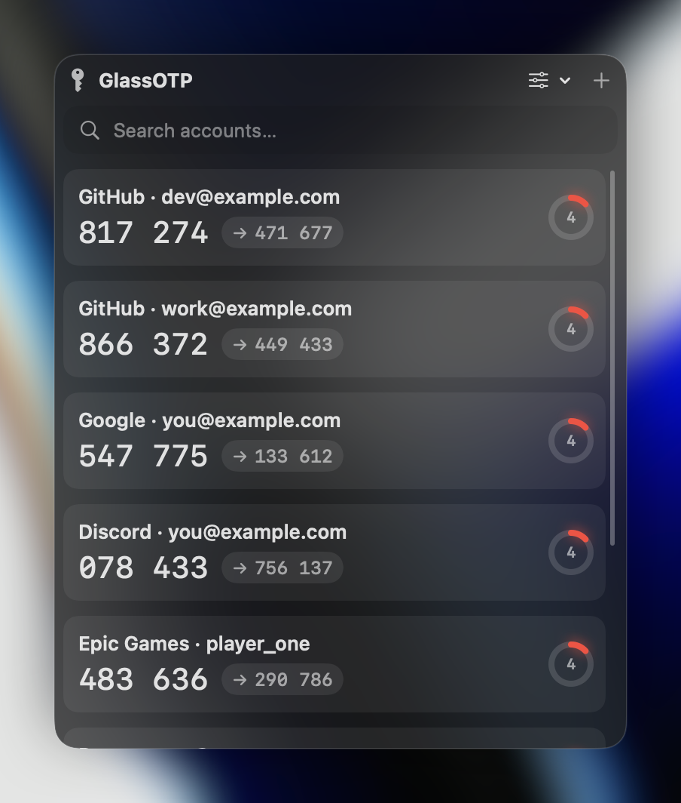
</p>

## Contents

- [Features](#features)
- [Installation](#installation)
- [Getting started](#getting-started)
- [Everyday use](#everyday-use)
- [Adding tokens](#adding-tokens)
- [Managing tokens](#managing-tokens)
- [Menu bar menu & settings](#menu-bar-menu--settings)
- [Backup & restore](#backup--restore)
- [Security](#security)
- [Troubleshooting](#troubleshooting)
- [Notes & limitations](#notes--limitations)
- [Building from source](#building-from-source)

## Features

**Fast**

- Lives in the menu bar — no Dock icon, one click or **⌥⌘O** away
- Click a row to copy its code; codes are grouped (`123 456`) for easy reading
- **Next code** appears in the last seconds of a period — copy it without waiting
- **Keyboard-first**: type to search, **↑/↓** to select, **Enter** to copy and jump back to your app
- **Press ⌥⌘O twice** to select a QR code anywhere on screen and add the account in one go
- **Frequently used first** — the accounts you copy most move to the top

**Flexible import**

- Time-based (**TOTP**), counter-based (**HOTP**) and **Steam Guard** codes
- **Move from another app** — 2FAS, Aegis, Authenticator Pro, Proton Authenticator, Ente Auth, Bitwarden and Steam Desktop Authenticator exports, password-protected ones too
- Text files or pasted blocks with many `otpauth://` links at once
- `otpauth://totp/…`, `otpauth://hotp/…`, `otpauth://steam/…` links and **Google Authenticator** exports (`otpauth-migration://…`)
- QR codes from an image or PDF, drag & drop, the clipboard, the **camera** or **anywhere on your screen**
- Manual entry — TOTP, HOTP or Steam, SHA1 / SHA256 / SHA512, 6 or 8 digits, any period or counter

**Private & secure**

- Secrets stored in the **macOS Keychain**, never in plain text on disk
- Optional **Touch ID / password lock** for the whole list
- **Protected tokens** — keep a single code hidden until you confirm with Touch ID
- **Recovery codes** — keep a site's backup codes next to the token, in the Keychain, behind Touch ID
- Touch ID required to show secrets and QR codes, export a backup or delete everything
- Encrypted, password-protected backups
- **No network connections** — nothing is synced, sent or uploaded

**Comfortable**

- Pin, rename and search tokens
- **Recently Deleted** — a deleted token can be restored for 30 days, or undone right away
- **Clipboard suggestions** — copy an `otpauth://` link or a QR screenshot, open GlassOTP and add it with one click
- **Add from anywhere** — *Add to GlassOTP* in the Services menu, or drop a QR image, PDF, link or export file onto the menu bar icon
- Close after copy, copy sound, launch at login — all optional

## Installation

### Homebrew

```sh
brew install --cask croakieee/tap/glassotp
```

Update with `brew upgrade --cask glassotp`. The cask removes the quarantine flag after installation, so the Gatekeeper step below is not needed.

### Manual

1. Download the release archive and extract it.
2. Move `GlassOTP.app` into your **Applications** folder.
3. Open it — the key icon appears in the menu bar.

### First launch (Gatekeeper)

GlassOTP is not distributed with an Apple Developer certificate, so macOS may block the first launch or say:

> "The application is damaged and can't be opened. You should move it to the Trash."

This is the quarantine flag macOS adds to downloaded files, not actual damage. Run once in Terminal:

```sh
xattr -r -c /Applications/GlassOTP.app
```

Then open the app normally (or Control-click → **Open** the first time).

Optional third-party helpers (not bundled with GlassOTP):

- [Sentinel](https://github.com/alienator88/Sentinel) — removes the `com.apple.quarantine` attribute (macOS 13+).
- AutoFix — clears quarantine attributes and fixes permissions on older systems.

## Getting started

Click the key icon in the menu bar (or press **⌥⌘O**). The list is empty at first — press **+** to add your first token.

<p align="center">
  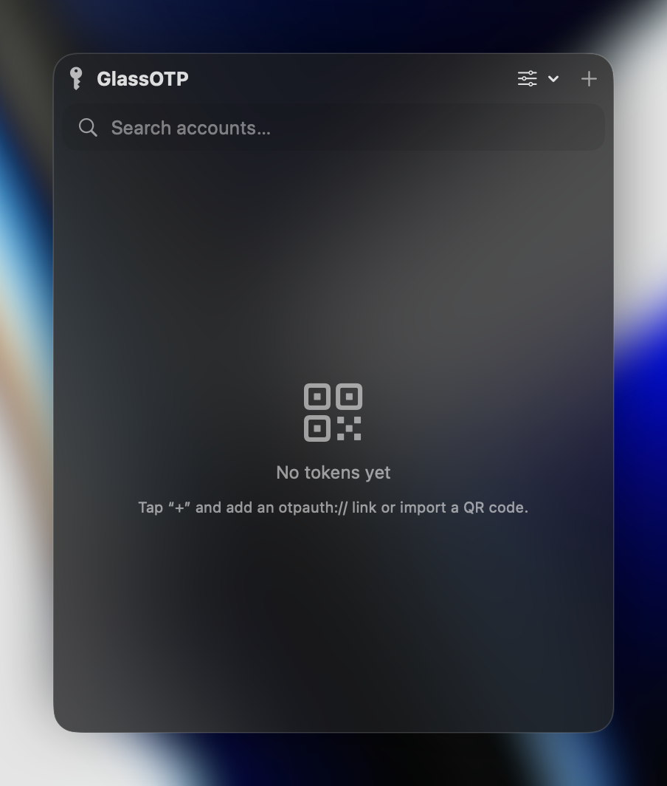
</p>

## Everyday use

### Copy a code

Click any row to copy its current code. A countdown ring shows how long the code stays valid; it turns orange and red near the end.

With **Frequently used first** (on by default), the accounts you copy most often and most recently move up. The order is updated only after the list closes, so rows never jump under your pointer. Pinned tokens always stay on top.

<p align="center">
  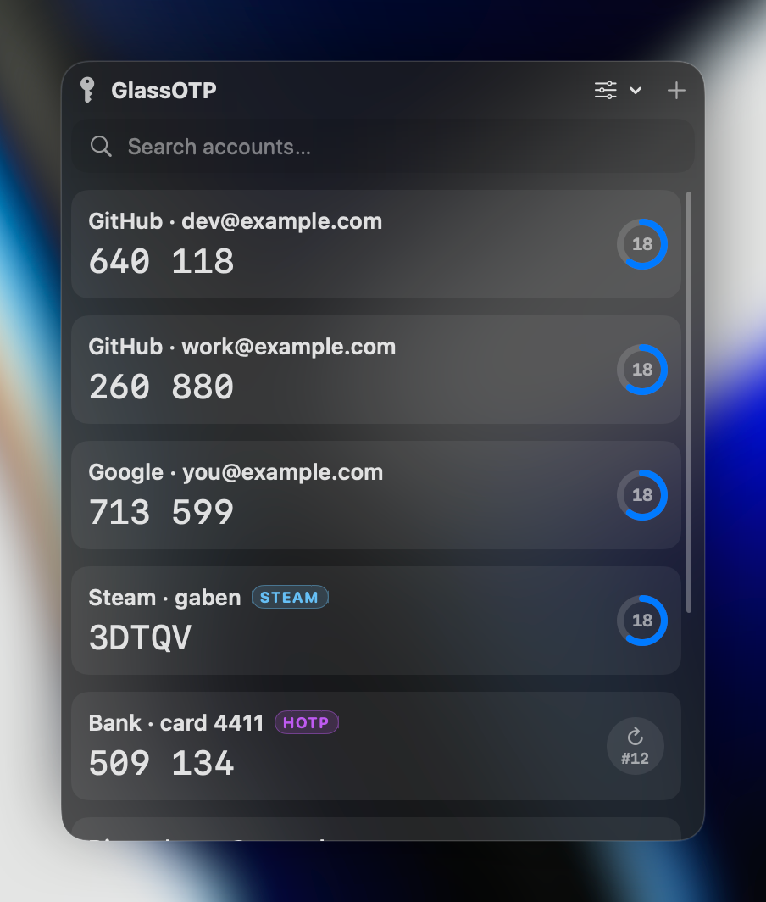
</p>

### Next code

In the last **5 seconds** of a period, the next code appears next to the current one in a **NEXT** badge, with a short glint so you notice it. Click the badge to copy the next code right away instead of waiting for the countdown — most services also accept the neighbouring code.

It is always clear which code you will copy:

- Pointer over the row — the row is highlighted and the **current** code is copied.
- Pointer over **NEXT** — the badge lights up, the current code dims and the **next** code is copied.
- After copying, the row shows **Copied** or the badge shows **Copied next**.

When the period rolls over, the next code slides into place.

<p align="center">
  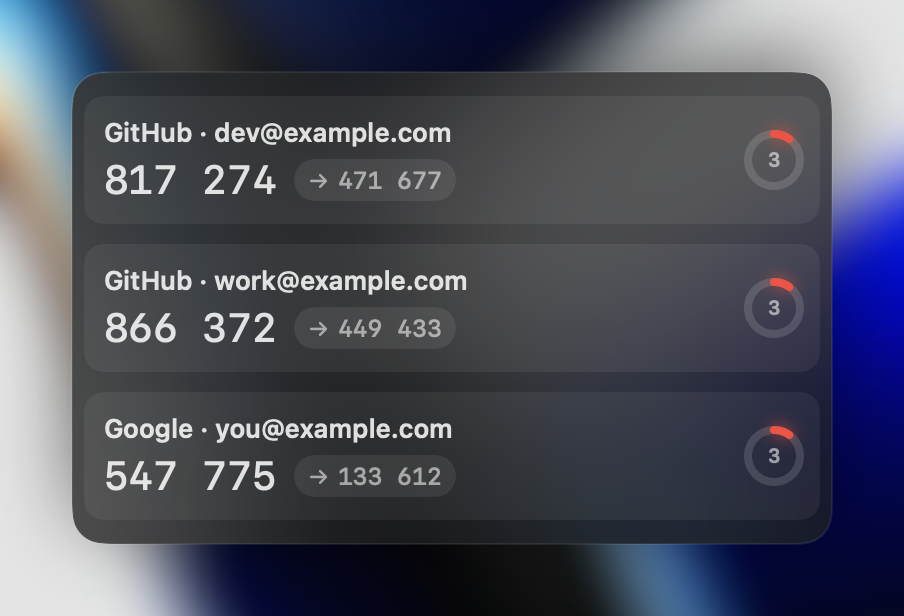
</p>

### Counter-based (HOTP) codes

Some banks and hardware-style tokens use **HOTP**: the code changes when you use it, not over time. Such rows carry a purple **HOTP** label, and instead of the countdown ring they show the counter, for example **↻ #12**.

- Click the row (or press **Enter**) to copy the code.
- Click **↻** to move to the next code, for example when a site rejected the last one.
- **HOTP: new code after each copy** in [settings](#menu-bar-menu--settings) decides what happens after copying:
  - **On** (default) — every copy moves to the next code, so a used code is never offered again. The copied code stays on screen while **Copied** is shown.
  - **Off** — copying keeps the same code; press **↻** when you need a new one.

### Steam Guard

Steam accounts carry a blue **STEAM** label and show Steam's own 5-character codes, such as `3DTQV`. They behave like regular codes: a countdown ring, the **NEXT** badge and keyboard copy all work.

<p align="center">
  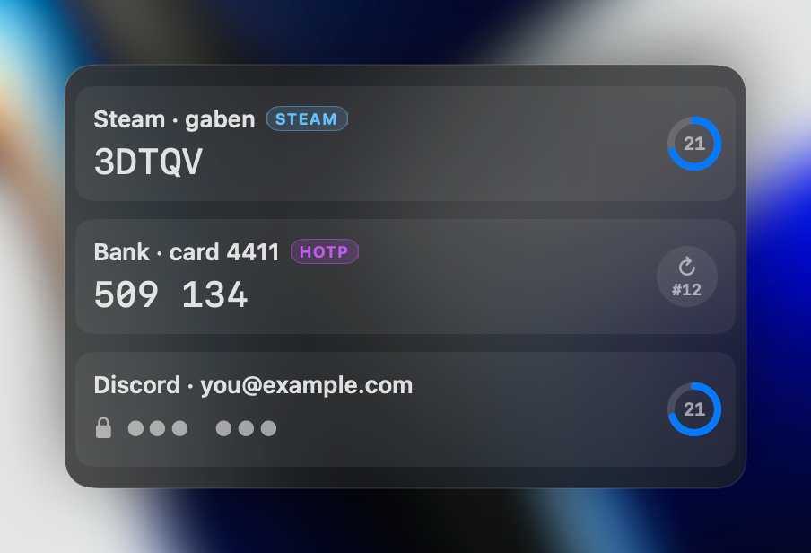
</p>

### Keyboard

| Key | Action |
| --- | --- |
| **⌥⌘O** | Open or close GlassOTP from any app |
| **⌥⌘O ⌥⌘O** (twice, quickly) | Select a QR code anywhere on screen and add the account — see [From anywhere](#from-anywhere) |
| *type* | Search — the first match is selected |
| **↑ / ↓** | Move the selection |
| **Enter** | Copy the selected code, close the window and return to the app you came from — ready for **⌘V** |

A pinned window stays open after **Enter**. The shortcut can be turned off in [settings](#menu-bar-menu--settings) if it conflicts with another app.

<p align="center">
  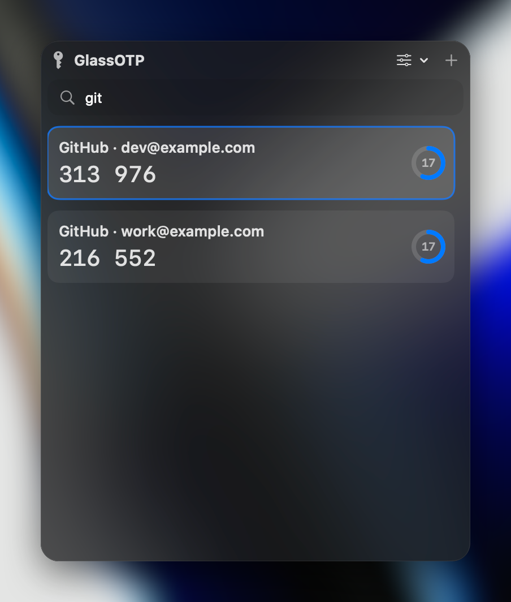
</p>

## Adding tokens

Press **+** in the top-right corner of the list to open the **Add Token** window.

### Link / QR

- **Drop** an image or PDF with a QR code onto the window, or click **Image…** (PDFs are searched page by page)
- **Paste** takes whatever is on the clipboard: `otpauth://` links (anywhere in the copied text), a copied image, or an image or PDF file copied in Finder.
- **Screen** reads QR codes from your screen — for example the one a website shows when you turn on two-factor login. Choose **Whole Screen** to find codes anywhere on your displays, or **Select Area…** to pick the QR code with the crosshair (Esc cancels). If a whole-screen scan finds nothing, GlassOTP offers **Select Area…** right away.
- **Camera** works with any camera: the built-in one, an iPhone (Continuity Camera, macOS 14+) or a virtual camera such as OBS.
- Or type a link into the **Link** field — `otpauth://totp/…`, `otpauth://hotp/…`, `otpauth://steam/…` or a Google Authenticator export (`otpauth-migration://…`, many tokens at once). You can paste many links at once, one per line.
- **Drop** a Steam Desktop Authenticator `.maFile` onto the window to add that Steam account.

Reading the screen needs the *Screen Recording* permission once: allow GlassOTP in System Settings → Privacy & Security → Screen Recording (the **Open Settings** button takes you there), then quit and reopen GlassOTP. Prefer not to grant it? Take a screenshot of the QR code to the clipboard with **⌃⇧⌘4** and press **Paste** — or simply open GlassOTP and use the [clipboard suggestion](#from-the-clipboard).

<p align="center">
  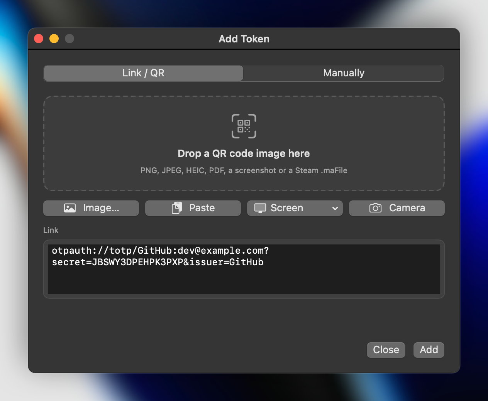
  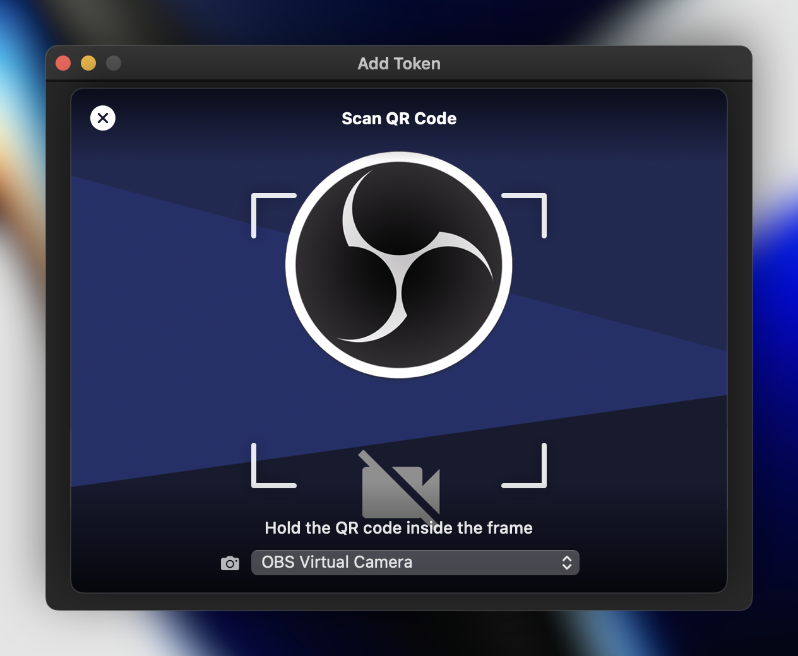
</p>

### Manually

Enter the issuer and/or account and the Base32 secret. Keep **Type** on **TOTP** unless the service says the codes are counter-based (**HOTP**) — then enter its starting **Counter** instead of the period. Choose **Steam** for a Steam Guard secret; it also accepts the `shared_secret` value from a `.maFile`. Change digits (6 or 8), period and algorithm (SHA1 / SHA256 / SHA512) only if the service says so.

<p align="center">
  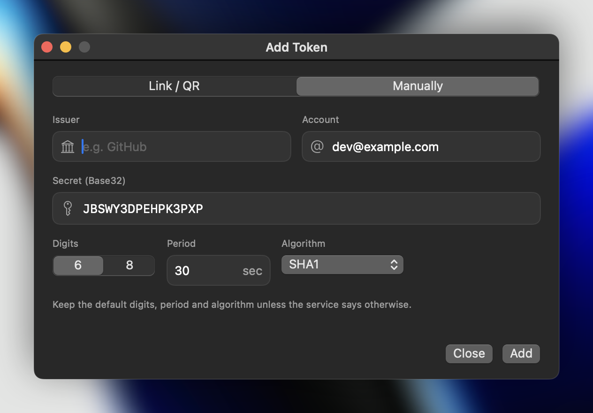
</p>

Press **Add**. The window stays open, so you can add several tokens in a row; **Close** or **Esc** closes it.

- Tokens that already exist are skipped.
- Entries GlassOTP can't generate codes for (MD5 in a Google Authenticator export) are skipped and counted in the result message.
- A token needs a name: an issuer, an account, or both.

### From anywhere

You don't have to open the Add window at all:

- **Press ⌥⌘O twice quickly** — the crosshair appears; select the QR code (Esc cancels) and the account is added. It needs the same Screen Recording permission as **Screen**. Turn it off with **Double ⌥⌘O to scan a QR code** in [settings](#menu-bar-menu--settings).
- **Services menu** — select an `otpauth://` link in any app, or right-click an image or a file in Finder, and choose **Services → Add to GlassOTP**. For files, macOS may ask you to enable it once in System Settings → Keyboard → Keyboard Shortcuts → Services. GlassOTP must be in your Applications folder and opened once.
- **Drop onto the menu bar icon** — a QR image, a PDF, an `otpauth://` link, a `.maFile` or any export GlassOTP can [import](#from-another-authenticator-app). Files with a password ask for it first.

Each time, GlassOTP opens and shows a line with the result — for example *Added “GitHub · me”* or *Already in GlassOTP*.

### From the clipboard

Copy an `otpauth://` link (or a screenshot of a QR code) and open GlassOTP: a line at the top offers the new account — click **Add**. GlassOTP then removes the link from the clipboard, since it contains the secret. **×** hides the offer until the clipboard changes; accounts you already have are never offered.

On macOS 26 and later, macOS asks before an app reads the clipboard by itself. There, GlassOTP shows *The clipboard may hold an account link* with a **Check** button instead, and only looks at the clipboard when you click it. Turn the feature off with **Suggest accounts from clipboard** in [settings](#menu-bar-menu--settings).

<p align="center">
  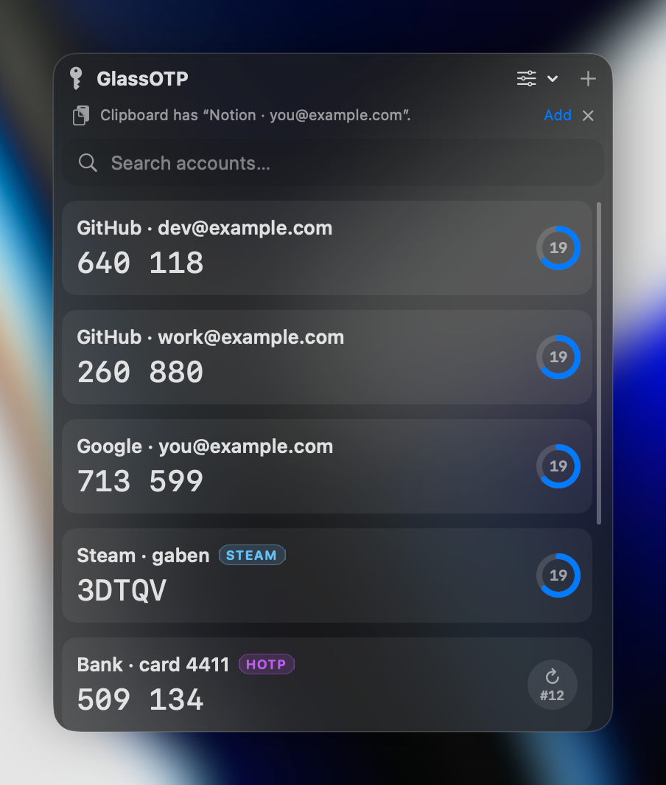
</p>

### From another authenticator app

Export your accounts in the other app, then right-click the key icon → **Import** and choose the file — or simply drop the file onto the key icon. GlassOTP recognises the format by itself and asks for a password only if the export has one.

| App | Export file | Password-protected export |
| --- | --- | --- |
| **2FAS** | `.2fas` backup | Supported |
| **Aegis** | `.json` vault export | Supported |
| **Authenticator Pro** | `.authpro` backup or a URI list (`.txt`) | Supported |
| **Proton Authenticator** | `.json` export | Supported |
| **Ente Auth** | Plain-text export (`.txt`) | Not supported — export as plain text |
| **Bitwarden** | `.json` or `.csv` vault export | Not supported — export without a password |
| **Any app** | A text file with `otpauth://` links, one per line | — |
| **Steam Desktop Authenticator** | See [below](#from-steam-desktop-authenticator) | Supported |

- Accounts that already exist in GlassOTP are skipped.
- Accounts GlassOTP can't generate codes for (for example Yandex, mOTP or 7-digit codes) are skipped and counted in the result.
- Delete the export file afterwards — it contains your secrets.

### From Steam Desktop Authenticator

Right-click the key icon → **Import** and choose a `.maFile` or the whole `maFiles` folder.

- **Encrypted** maFiles: choose the `maFiles` folder (GlassOTP needs its `manifest.json`) and enter your Steam Desktop Authenticator encryption passkey.
- Each account's **revocation code** is saved in its [recovery codes](#recovery-codes) as *Steam revocation code* — you need it to remove the authenticator from your Steam account.
- GlassOTP shows Steam Guard login codes only. Trade and market confirmations need Steam's servers, so keep using the Steam app or Steam Desktop Authenticator for those.

## Managing tokens

Right-click a token:

- **Pin / Unpin** — keep important tokens at the top; unpinning puts a token back where it was
- **Rename…** — change the issuer or account
- **Show QR code** — move the token to another authenticator *(requires Touch ID / password)*
- **Show / edit secret…** — view or replace the Base32 secret *(requires Touch ID / password)*
- **Recovery Codes…** — keep the site's backup codes with the token *(requires Touch ID / password)*
- **Protect with Touch ID** / **Remove Touch ID Protection** — hide this token's code behind Touch ID
- **Delete** — move the token to [Recently Deleted](#recently-deleted)

<p align="center">
  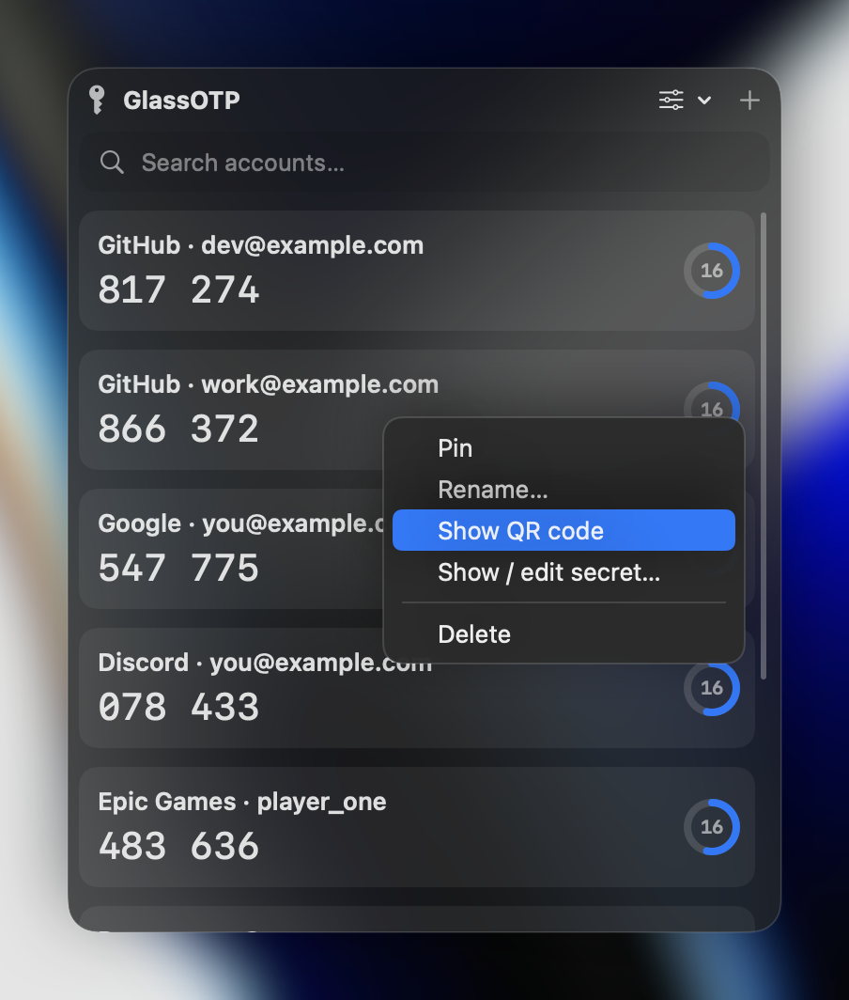
  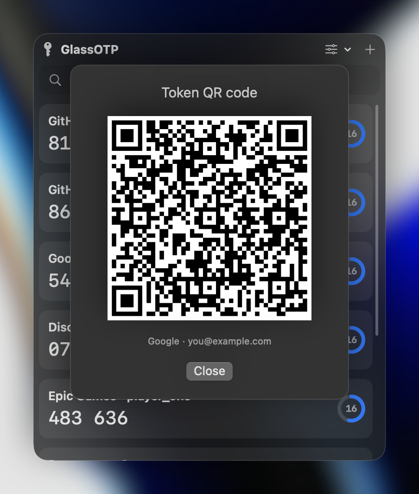
</p>

### Protected tokens

**Protect with Touch ID** hides one token's code behind dots and a lock — useful for a bank or your main e-mail, even when the rest of the list is open.

- Click the row or press **Enter**: confirm with Touch ID (or your password), and the code is shown and copied. It stays visible until the list closes.
- The **NEXT** badge appears only after the code is shown.
- **Show QR code** and **Show / edit secret…** always ask for Touch ID for a protected token.
- Removing the protection also needs Touch ID.

### Recovery codes

Sites that offer two-factor login usually give you a set of single-use **recovery codes** for when your authenticator isn't at hand. **Recovery Codes…** keeps them with the token.

- Paste the codes as the site shows them — one per line, comma-separated or numbered, all work. Duplicates are skipped.
- Mark a code as used with the circle next to it; **Copy** copies one code, **Copy unused** copies all remaining ones.
- The codes are stored in the Keychain together with the secrets and open only after Touch ID. They are part of encrypted backups.

<p align="center">
  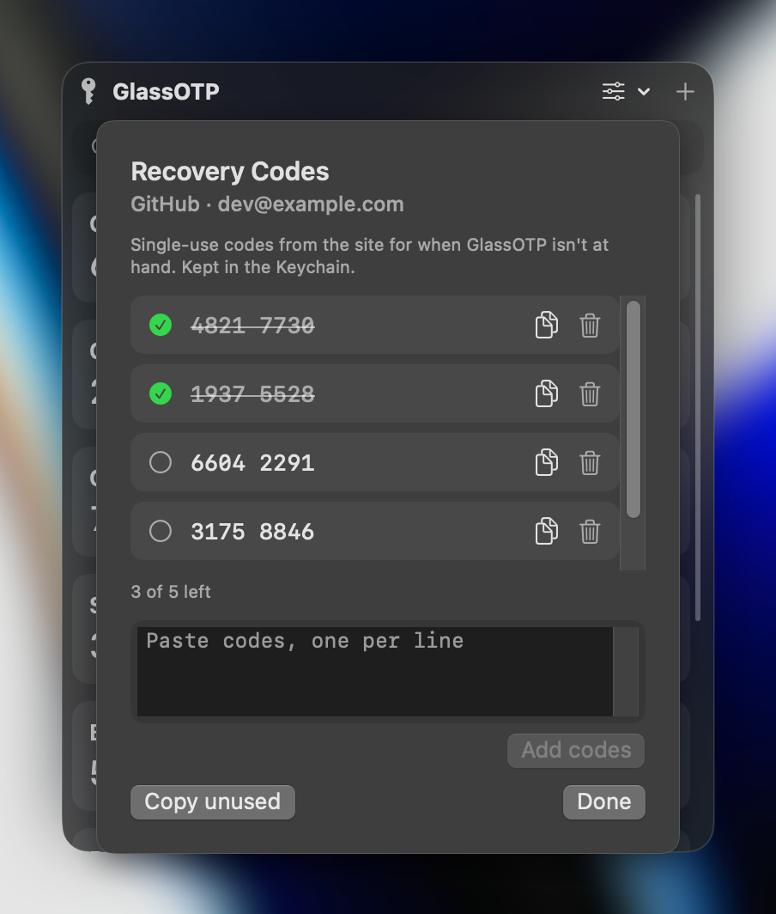
</p>

### Recently Deleted

**Delete** moves a token to **Recently Deleted** instead of erasing it. Right after deleting, an **Undo** button appears at the top of the list for a few seconds.

Open **Recently Deleted…** from the settings menu to **Restore** a token or delete it for good. Tokens there are removed automatically after **30 days**; **Empty** removes them all at once. A restored token comes back with its secret, recovery codes and protection.

<p align="center">
  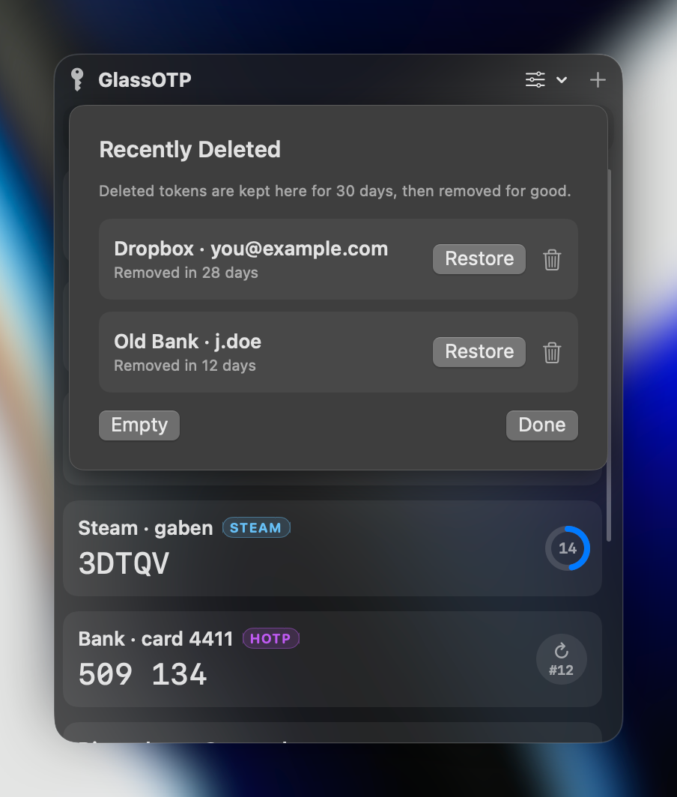
</p>

## Menu bar menu & settings

**Right-click** the key icon for the quick menu:

- **Open** — show the token list
- **Export / Import** — [backup & restore](#backup--restore); **Import** also reads exports from [other authenticator apps](#from-another-authenticator-app)
- **Delete All** — remove every token and reset the secret storage *(requires Touch ID / password)*
- **Pin popover** — keep the list open when you click elsewhere
- **Launch at login** — start GlassOTP when you log in. Enable it from the copy in **Applications**; if you move the app, turn it on again, and turn it off before deleting the app.
- **Exit**

The **settings menu** (slider icon in the list):

- **Close after copy** — close the list shortly after copying (a pinned list stays open)
- **Play sound on copy**
- **Frequently used first** — sort by how often and how recently you copy a code
- **HOTP: new code after each copy** — shown when you have HOTP tokens, see [Counter-based (HOTP) codes](#counter-based-hotp-codes)
- **Suggest accounts from clipboard** — offer accounts from a copied link or QR screenshot, see [From the clipboard](#from-the-clipboard)
- **Global shortcut ⌥⌘O**
- **Double ⌥⌘O to scan a QR code** — press the shortcut twice to scan a QR code anywhere on screen, see [From anywhere](#from-anywhere)
- **Require Touch ID to view** — lock the list until you authenticate
- **Recently Deleted…** — [restore or erase deleted tokens](#recently-deleted)

<p align="center">
  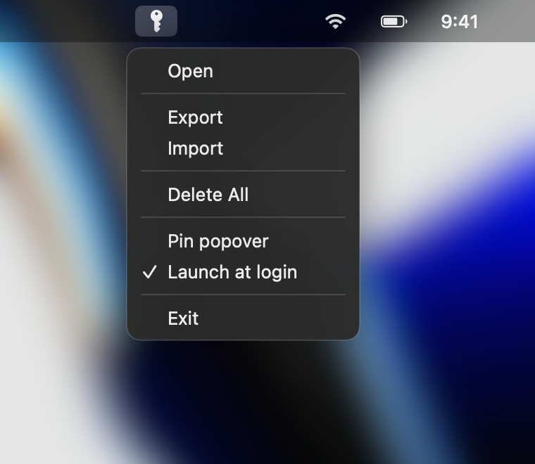
  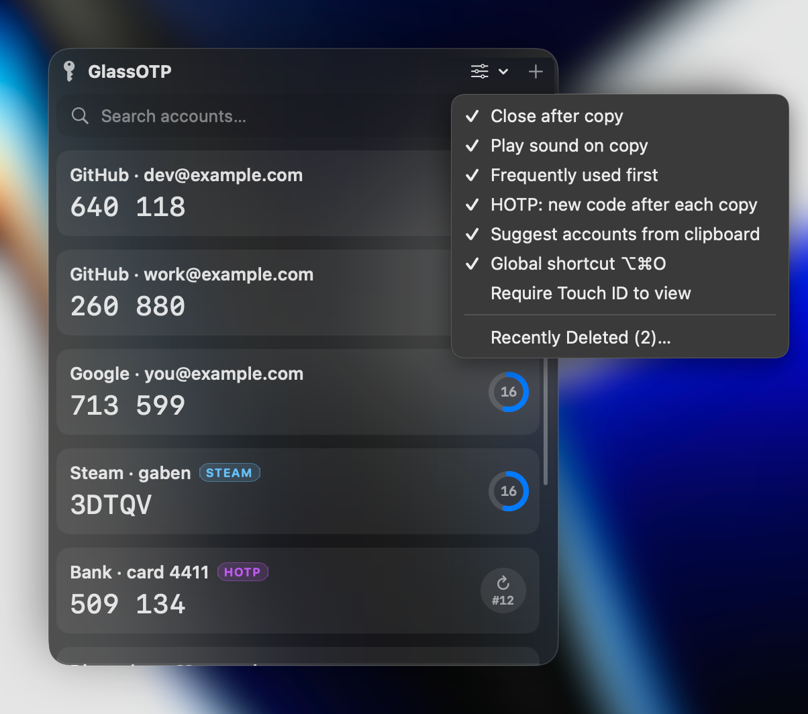
</p>

## Backup & restore

From the right-click menu:

- **Export** — authenticate, choose a location, set a password and save an encrypted `.glassotp` file with all tokens, including their recovery codes, protection and HOTP counters. Tokens in Recently Deleted are not included. GlassOTP warns you if the password is shorter than 8 characters.
- **Import** — select a `.glassotp` file and enter its password. New tokens are added, existing ones are skipped. Backups made by earlier versions import as before.

> A backup that contains HOTP or Steam accounts needs GlassOTP 1.3 or later to import correctly. Backups made by newer versions use a stronger key (Argon2id) and can't be opened by GlassOTP 1.3 or earlier — older backups still import as before.

> The backup file contains all your secrets. Choose a strong password and keep the file somewhere safe.

## Security

- Token secrets live in the **macOS Keychain**, never as plain text on disk.
- GlassOTP makes **no network connections** — all data stays on your Mac.
- **Touch ID** or your macOS password is required to view or edit a secret, show a QR code, open recovery codes, export a backup and delete all tokens. Authentication is remembered for a short time to avoid repeated prompts — except for protected tokens and recovery codes, which always ask.
- **Require Touch ID to view** hides all codes until you authenticate, every time the list opens.
- **Protected tokens** stay hidden behind Touch ID even when the list itself is open.
- **Recovery codes** are kept in the Keychain next to the secrets, never in plain text on disk.
- Backups are encrypted with **AES-GCM** using a key derived from your password with **Argon2id** (64 MB of memory per attempt, which makes guessing the password slow). Backups from earlier versions used PBKDF2-HMAC-SHA256 and still import. Without the password, a backup can't be read.
- If macOS can't verify you (for example, the Mac has no login password), GlassOTP keeps everything locked instead of letting you through.
- Copied codes are marked as sensitive, so well-behaved clipboard managers don't store them.
- The clipboard is checked only when you open the list and only if it changed; an added `otpauth://` link is removed from it.
- Screen scans never leave your Mac: they are read for QR codes and deleted right away. On macOS 15 and later, macOS periodically asks you to confirm GlassOTP's Screen Recording access.

<p align="center">
  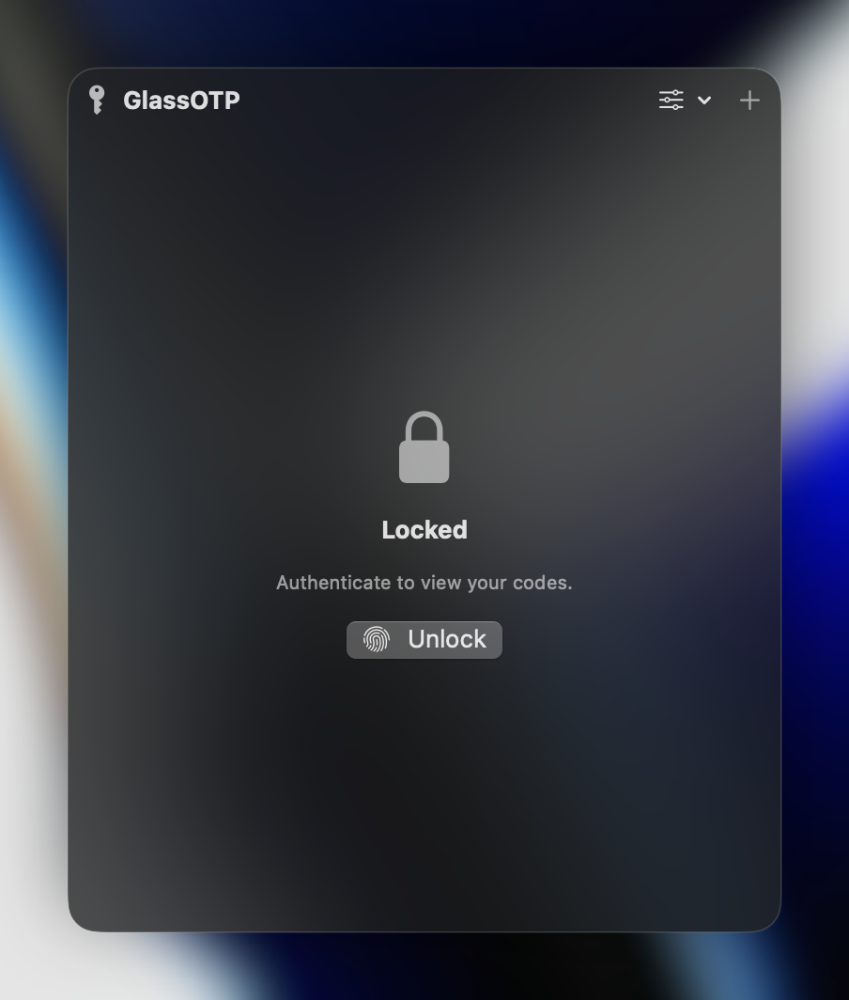
</p>

## Troubleshooting

| Message in the list | What to do |
| --- | --- |
| **No access to the Keychain** | You declined the Keychain password prompt. Click **Retry** and allow access. |
| **Secret storage is damaged** | Use **Delete All** in the right-click menu, then **Import** a backup. The damaged data is kept aside in the Keychain, not destroyed. |
| **Some saved tokens couldn't be read** | Restore the missing tokens from a backup with **Import**. |
| **Notifications are off** | Click **?** next to the message to open System Settings and allow notifications for GlassOTP. Until then, export / import / delete confirmations won't appear as notifications; import errors are still shown as a dialog. |

- **Screen scanning keeps asking for permission** — after allowing GlassOTP under Screen Recording, quit GlassOTP (right-click the key icon → **Exit**) and open it again; macOS applies the permission only to a fresh start.
- **Add to GlassOTP is missing from the Services menu** — make sure GlassOTP is in your Applications folder and has been opened once, then enable it in System Settings → Keyboard → Keyboard Shortcuts → Services. If it still doesn't appear, log out and back in — macOS refreshes the Services list only then.
- **⌥⌘O does nothing** — another app may already use this shortcut. Turn off **Global shortcut ⌥⌘O** in settings and use the menu bar icon instead.

## Notes & limitations

- **TOTP** (time-based) and **HOTP** (counter-based) codes with **6 or 8 digits**, and **Steam Guard** codes (5 characters).
- Steam trade and market confirmations are not supported — GlassOTP never connects to the network.
- An HOTP counter lives only on this Mac. If the same HOTP token is also used in another app, the counters drift apart — press **↻** until the site accepts a code.

## Building from source

Requirements: **Xcode 16.3 or later** (macOS 15.4 SDK or newer). The app itself runs on macOS 11.7 and later.

```sh
git clone https://github.com/Croakieee/GlassOTP.git
cd GlassOTP
open GlassOTP.xcodeproj
```

Build and run the **GlassOTP** scheme.

## Contributing

Pull requests and improvements are welcome.
If you find a bug or have a feature request, please open an issue.

## Disclaimer

GlassOTP is an open source project provided without warranty. Use it at your own risk.
For maximum security, always keep recovery/backup codes for your accounts.

Released under the [MIT License](LICENSE).

## ☕ Support the Project

If you like this project and want to support its development, you can buy me a coffee using **USDT (TRC20)**.

<div align="center">

<a href="https://tronscan.org/#/address/TKy58zzJkoTzab3XZXE5YpZVpH3oRoghjg">
  
</a>

</div>

<p align="center">

**USDT (TRC20) Wallet**

`TKy58zzJkoTzab3XZXE5YpZVpH3oRoghjg`

</p>

---

⭐ Any support helps keep the project improving and maintained.
